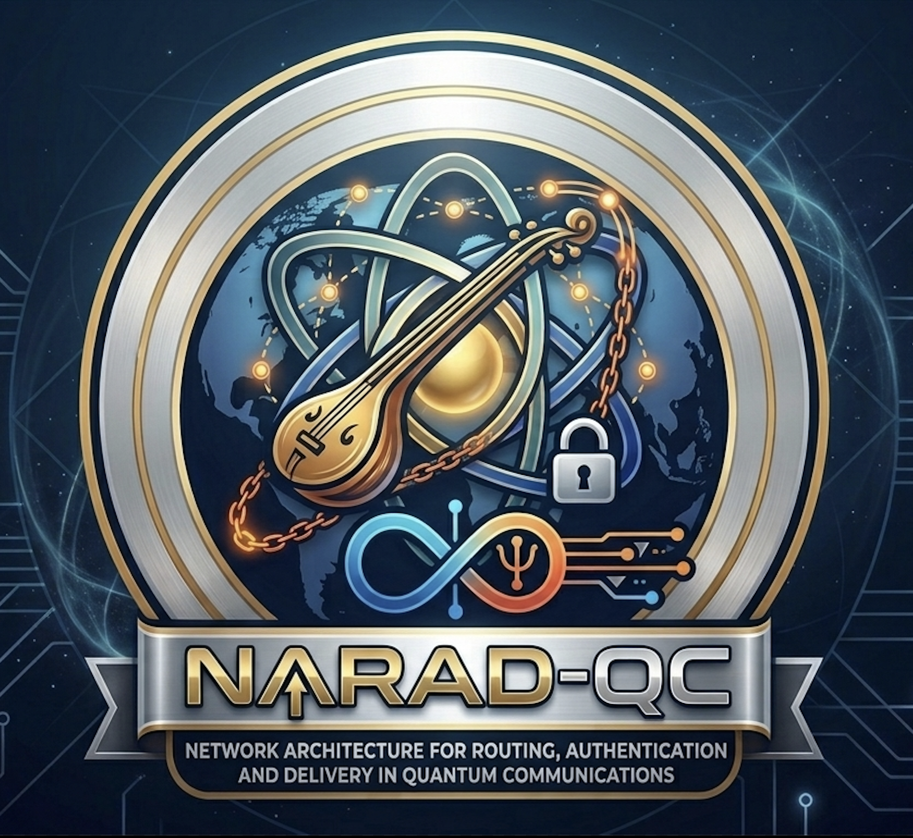
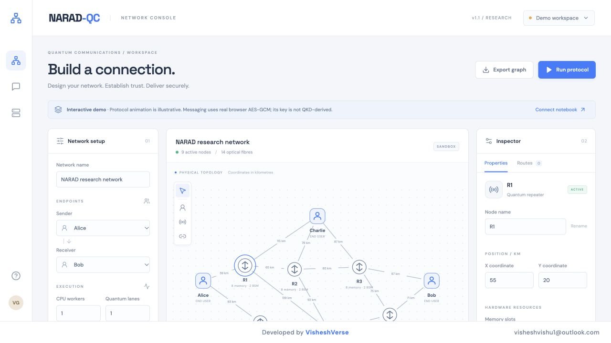
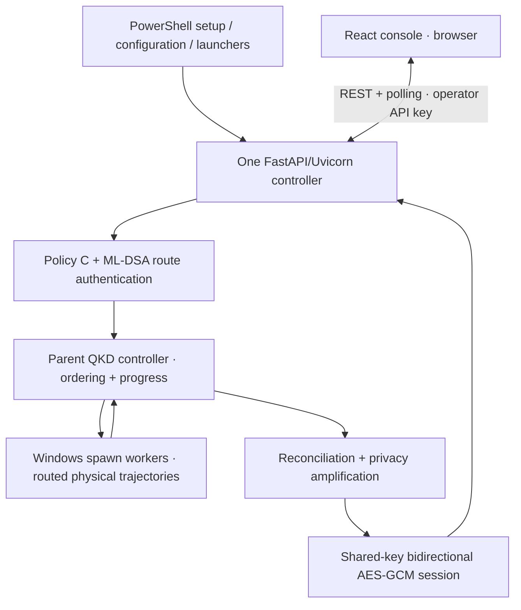

<p align="center">
  
</p>

<h1 align="center">NARAD-QC · Windows Edition</h1>
<p align="center"><b>Network Architecture for Routing, Authentication and Delivery in Quantum Communications</b></p>
<p align="center">The same protocol engine and React console, with native Windows process workers and PowerShell launchers.</p>

<p align="center">
  
  
  
  
</p>

---

## 📝 Overview

NARAD-QC explores how a quantum communication network can find reliable routes between users, authenticate the selected nodes, deliver usable end-to-end entanglement, and distill a shared key for encrypted communication.

This Windows edition uses the **same Python protocol definitions, calibration models, API contracts, and React frontend** as the main project. It adds native Windows process initialization and PowerShell setup/launch scripts. There is no separate simplified Windows simulator to drift away from the main engine.

Design your network in the browser, configure repeater memory and BSM resources, choose optical modes and execution capacity, preview routes, and run the protocol. Watch coloured directional arrows and real progress metrics, then exchange AES-GCM messages in both directions using the established session key.

**Project scope:** quantum-network execution is a software simulation; ML-DSA authentication and AES operations execute cryptographic routines. This remains a research system with physical and security-model assumptions, rather than a deployed quantum-hardware network or a production multi-user chat service.

**Verification boundary:** Windows-style `spawn` processes, seeded trajectory equivalence, real QKD, telemetry, and messaging have been exercised on macOS. All pinned dependencies resolve to Python 3.12 Windows x64 wheels. The PowerShell scripts and application have not yet been executed on a physical Windows host. Run the supplied verification command on your Windows installation before treating that deployment as verified.

## 📑 Contents

- [Features](#-features)
- [Architecture and Windows compatibility](#-architecture-and-windows-compatibility)
- [Protocol phases](#-protocol-phases)
- [Prerequisites](#-prerequisites)
- [Complete Windows setup](#-complete-windows-setup)
- [Run a first session](#-run-a-first-session)
- [Workers and hard limits](#-workers-and-hard-limits)
- [PowerShell command reference](#-powershell-command-reference)
- [Verification](#-verification)
- [Troubleshooting](#-troubleshooting)
- [Hosting and lifecycle](#-hosting-and-lifecycle)
- [Author](#-author)

---

## ✨ Features

### Protocol / backend

- User/repeater topologies with positions, active fibres, attenuation, optical modes, memory slots, and BSM capacity.
- Repeater-only path discovery, hardware feasibility, and QKD quality checks.
- Empirically calibrated Policy C routing using reliability, latency, and delivered-quality predictions.
- ML-DSA authentication before quantum operations are authorized.
- Finite-memory entanglement generation, physical timing, decoherence, swapping, expiry, and recovery.
- Biased-basis BBM92, parameter estimation, Cascade reconciliation, and Toeplitz privacy amplification.
- Windows-compatible parallel trajectory workers, with separate CPU-worker and quantum-lane controls.
- Native progress, execution audits, idempotent GUI job submission, and backend-held session keys.
- One-time calibration preparation and a physics-equivalence-checked worker benchmark.

### Frontend

- The existing React 19/Vite network editor and inspector.
- Blue-and-white splash with the NARAD-QC and VisheshVerse logos.
- Persistent developer footer, website link, and contact email.
- Coloured arrows, incremental protocol logs, routing preview, and live QKD measurements.
- Alice and Bob composers/inboxes using one shared AES-GCM key with unique nonces across both directions.
- Graph import/export and an explicitly labelled standalone demo.

<p align="center">
  
  <br><em>The shared frontend. Its initial demo must be connected to the backend to execute the actual protocol.</em>
</p>

## 🏗️ Architecture and Windows Compatibility



Windows does not provide the notebook's original `fork` process model. The standalone backend now selects **`spawn` on Windows**. Each worker imports the actual engine and explicitly receives its selected topology/path, QKD configuration, and deterministic trajectory seeds. It initializes its own local protocol state before calculating the same trajectory function.

The parent retains route selection, measurement ordering, lane scheduling, progress reporting, key distillation, and session/inbox state. The initialization payload excludes API keys, session secrets, locks, and the complete engine namespace. Like other child processes, workers inherit ordinary process environment variables. The notebook's local authentication gate still runs within each reconstructed physical trajectory, as it did in the existing routed executor.

Linux/macOS retain `fork` by default. `NARAD_MP_START_METHOD=spawn` can also exercise the Windows process path on those platforms. Changes to process creation do not change the physical model, QKD rules, or message format. Independent live sessions still generate fresh keys; equivalent behavior does not imply identical keys across separate runs.

## 🧬 Protocol Phases

| Phase | Purpose |
|---|---|
| **0–2 — Research baselines** | Point-to-point QKD, distance effects, and single-repeater experiments in the original notebook. These historical demo runners are not executed at server startup. |
| **3 — Physical engine** | Authenticated nodes, finite memory, generation, swapping/recovery, timing, and BBM92 distillation. |
| **4 — Routing** | Operator graphs, feasible paths, empirical service calibration, and Policy C ranking. |
| **5 — Integration** | Route selection → authentication → quantum execution → final shared key, with route fallback. |
| **6 — API** | Request semantics, access control, sessions, idempotency, parallel workers, and native progress. |
| **GUI bridge** | Custom graph jobs, incremental logs/telemetry, and bidirectional AES inboxes. |

For the full research walkthrough, model assumptions, and experiment outputs, see the [main README](README.md).

---

## 🔧 Prerequisites

For the native setup below, use:

- **64-bit Windows with x64 Python 3.12**. This edition targets Windows x64; Windows ARM64 has not been qualified.
- The Python Launcher (`py`), installed with your Python distribution.
- **Git**.
- **Node.js 20.19+ or 22.12+**, including npm.
- **PowerShell** and a current browser.
- The project's calibration CSV, or a trusted matching fitted-model bundle.

This native path does **not** require WSL, Docker, Jupyter, Colab, or a Cloudflare tunnel.

Open PowerShell and check:

```powershell
git --version
py -3.12 --version
node --version
npm.cmd --version
```

The scripts deliberately use `npm.cmd`, so npm does not depend on permission to execute the separate `npm.ps1` shim. Python environments use `Scripts\python.exe`; Linux/macOS virtual environments cannot be copied across platforms.

## 🚀 Complete Windows Setup

### 1 — Clone

```powershell
git clone https://github.com/Vishesh-Goyal7/NARAD-QC.git
cd NARAD-QC
```

This directory is the repository root. Run the commands below from here. Open a **second PowerShell terminal** later for the frontend.

If PowerShell blocks a local script, review it and invoke that script in a single process with:

```powershell
powershell -NoProfile -ExecutionPolicy Bypass -File .\windows\Setup.ps1
```

Use the corresponding script filename for later commands if needed. This applies the execution-policy choice to that process; changing the machine-wide policy is unnecessary. Organizational policy may still prohibit script execution.

### 2 — Install backend and frontend dependencies

```powershell
.\windows\Setup.ps1
```

This creates `backend\.venv` using Python 3.12, installs `backend\requirements.lock.txt`, and installs React dependencies with `npm.cmd --prefix gui ci`. Each native command is checked for failure before proceeding. No calibration or long benchmark is hidden in setup.

### 3 — Prepare real routing calibration

The supplied study's raw file is:

```text
backend\artifacts\phase4_calibration_raw.csv
```

If it is absent from your clone, obtain **`phase4_calibration_raw.csv`** from the project's Google Drive resources linked in GitHub or from the maintainer. Its original Drive path is `NARAD_QC/checkpoints/phase4_routing_calibration/phase4_calibration_raw.csv`. Use the raw Phase 4 file, not an experiment summary.

Fit once in the Windows environment:

```powershell
.\windows\Prepare-Calibration.ps1
```

Or specify another location:

```powershell
.\windows\Prepare-Calibration.ps1 -CsvPath "$HOME\Downloads\phase4_calibration_raw.csv"
```

The output is `backend\artifacts\policy_c.joblib` plus `policy_c.json`. The server loads both; normal startup does not repeat fitting. This command uses the original calibration/model-selection code and does not regenerate quantum trajectories.

A trusted existing model/JSON pair can be reused when its scikit-learn version matches the pinned environment. Local fitting is the straightforward way to ensure a version match. Never load an untrusted joblib artifact.

### 4 — Benchmark your Windows machine once

Run with the backend stopped and other heavy jobs closed:

```powershell
.\windows\Benchmark-Workers.ps1
```

The benchmark tries worker counts available to the current process. For every count, the same seeded trajectories must match the one-worker reference. It measures throughput, wall/CPU time, observed processes, and resource samples. It recommends the smallest count within 3% of the best median throughput.

The default 600 km / six-repeater / eight-mode workload runs at least 48 pairs with three repeats per count and can take substantial time. The result is written to:

```text
backend\artifacts\workers.json
```

Read it:

```powershell
$report = Get-Content .\backend\artifacts\workers.json -Raw | ConvertFrom-Json
$report.recommended_workers
$report.physics_equivalent
$report.process_start_method
```

The last two values should be `True` and `spawn`. Do not reuse the repository author's macOS/fork profile as your Windows recommendation. The configuration helper rejects an automatic recommendation from a non-spawn profile.

Optional customized benchmark, using only worker counts your machine supports:

```powershell
.\windows\Benchmark-Workers.ps1 -Workers '1,2,4' -Pairs 48 -Repeats 3
```

A short **smoke check**, useful for verifying spawn setup but not for selecting deployment capacity:

```powershell
.\windows\Benchmark-Workers.ps1 -Workers '1,2' -Pairs 4 -Repeats 1 -DistanceKm 20 -Repeaters 1 -Modes 8
```

Both commands overwrite `workers.json`. Run your representative full benchmark afterward before choosing the production cap. Rerun on the actual hosting machine if it differs from your development PC.

### 5 — Configure the API key and hard worker cap

```powershell
.\windows\Configure.ps1
```

This reads the successful spawn benchmark, bounds its recommendation by current CPU capacity and the 64-worker HTTP limit, and writes an explicit `NARAD_CONTROLLER_MAX_CPU_WORKERS` to `backend\.env`. It creates a random private API key if one does not exist and preserves an existing key.

To choose a lower/manual cap:

```powershell
.\windows\Configure.ps1 -MaxWorkers 2
```

A conservative first start without benchmarking is possible with `-MaxWorkers 1`; it does not replace a proper capacity study. CPU affinity is considered on Windows. Values above current capacity are clamped.

Inspect/edit configuration locally:

```powershell
notepad .\backend\.env
```

Typical fields are:

```dotenv
NARAD_API_ACCESS_KEY=your-private-generated-key
NARAD_ALLOWED_ORIGINS=http://127.0.0.1:5173,http://localhost:5173
NARAD_CALIBRATION_PATH=backend/artifacts/policy_c.joblib
NARAD_CONTROLLER_MAX_CPU_WORKERS=2
NARAD_MP_START_METHOD=spawn
```

The helper also retains a valid spawn worker-profile path when available. Keep your private key out of Git and public frontend builds. The launcher parses `.env` as data rather than executing it as PowerShell code.

### 6 — Start the backend: Terminal 1

```powershell
.\windows\Start-Backend.ps1
```

Leave it running. It starts **one** Uvicorn controller at `http://127.0.0.1:8002`, loads your real calibration models, and enables the internal spawned trajectory farm.

Check:

```powershell
Invoke-RestMethod http://127.0.0.1:8002/health
Invoke-RestMethod http://127.0.0.1:8002/ready
```

Readiness should be true and report your controller limit. API documentation is at `/docs` for the GUI bridge and `/api/docs` for the original notebook API.

### 7 — Start the frontend: Terminal 2

In another PowerShell terminal, navigate to the repository and run:

```powershell
cd C:\path\to\NARAD-QC
.\windows\Start-Frontend.ps1
```

Replace the example path with your clone location. Open **http://127.0.0.1:5173**. The frontend uses a fixed port and fails if it is occupied rather than silently switching to a CORS-incompatible origin.

### 8 — Connect

1. Select **Connect notebook** in the frontend. The existing label also accepts a standalone Windows backend.
2. Enter `http://127.0.0.1:8002` without `/gui` or `/api`.
3. Open `backend\.env` privately and copy the value after `NARAD_API_ACCESS_KEY=` into the dialog.
4. Select **Test & connect** and confirm the applied capacity display.

Without this connection, the frontend remains in labelled demo mode. No Colab runtime is needed for connected Windows execution.

## 🧪 Run a First Session

Import [`gui/examples/first-run-network.json`](gui/examples/first-run-network.json) using **Import JSON**. It contains a 200 km chain:

```text
Alice ←→ R1 ←→ R2 ←→ Bob
```

Use:

| Setting | First-run value |
|---|---|
| Sender / receiver | Alice / Bob |
| Target secret | 128 bits |
| CPU workers | Your configured cap or a smaller count |
| Quantum lanes | 8 |
| Optical modes per fibre | 8, already in the imported graph |
| Maximum hops | 8 |
| Maximum delivered pairs | 5000 |
| Other QKD settings | Defaults |

Preview the route, then run the protocol. Watch routing/authentication/generation/distillation stages and native metrics. A key becomes usable only after successful post-processing, not merely when a forecast reaches 100%.

Once established, send from Alice and verify/decrypt in Bob's inbox, then reply from Bob and verify/decrypt in Alice's inbox. Both use one shared session key, with a locked nonce counter preventing reuse across directions. The key remains in the backend.

The spawn-based 200 km validation completed locally in approximately 159 seconds; this is an observed functional run, not a Windows-machine performance guarantee. Stochastic outcomes, workload, CPU count, and startup overhead affect runtime.

## ⚙️ Workers and Hard Limits

```text
Applied workers <= min(requested workers, quantum lanes,
                       available CPU capacity, configured controller cap)
```

The GUI/original HTTP request contracts also limit worker input to 64 and quantum lanes to 512. A single causal lane uses one worker. Runtime failure may activate the existing direct-worker fallback while preserving physical-lane semantics; inspect the actual audit rather than assuming a request was fulfilled.

CPU workers calculate trajectories. Quantum lanes represent independently provisioned route trajectories. Optical modes multiplex elementary fibre attempts. These controls remain separate on Windows.

Do not pass Uvicorn `--workers 4` to request four simulation workers. Jobs, locks, sessions, and inboxes are process-local. Keep **one HTTP controller** and configure the internal worker cap instead. Restart the backend after changing `.env`, then reconnect the frontend.

## 🗂️ PowerShell Command Reference

| Script | Purpose |
|---|---|
| `windows\Setup.ps1` | Create the native Windows Python environment and install backend/frontend dependencies |
| `windows\Prepare-Calibration.ps1` | One-time fit from the actual raw calibration CSV |
| `windows\Benchmark-Workers.ps1` | One-time spawned trajectory scaling and equivalence benchmark |
| `windows\Configure.ps1` | Generate/preserve the private key and set an explicit worker cap |
| `windows\Start-Backend.ps1` | Load local environment data and start the backend |
| `windows\Start-Frontend.ps1` | Start the shared React frontend |
| `windows\Verify.ps1` | Run small backend process-parity checks, frontend tests, and a production frontend build |

Other shared files:

- `backend/narad_backend/parallel.py`: selects the process model and adapts notebook pool creation.
- `backend/narad_backend/process_workers.py`: importable child-process entry points and explicit initialization.
- `windows/run_backend.py`: guarded launcher with `multiprocessing.freeze_support()`.
- `windows/configure.py`: data-only `.env` parsing and configuration.
- `backend/tests/test_parallel.py`: actual seeded physical comparisons between direct and spawned execution, plus fork comparisons on POSIX.

The generated engine/transport/farm source and physics equations stay shared. Notebook extraction does not remove the separate platform adapter.

## ✅ Verification

On Windows, after installation:

```powershell
.\windows\Verify.ps1
```

The POSIX-only fork test is skipped on Windows; the direct-versus-spawn comparison runs with actual physical trajectories. Verification does not fit calibration or launch a long QKD session. Complete the first-session exercise above to validate the full protocol on your installation.

During implementation, the following passed on macOS with explicit Windows-style spawn:

- Seeded routed trajectories matched direct execution and the original fork path.
- One/two-worker benchmark preserved physical outcomes and saved a spawn-tagged recommendation.
- Actual calibration, route preview, ML-DSA, 128-bit QKD establishment over 200 km, live progress, two observed worker processes with no fallback, and AES messages in both directions.
- Windows x64 Python 3.12 wheel resolution/download for the complete pinned runtime, including NumPy, SciPy, scikit-learn, pqcrypto, and PyCryptodome.

These checks establish process-path compatibility but do not substitute for running the PowerShell scripts and binary packages on a real Windows host. See [Windows validation notes](windows/VALIDATION.md) for the precise scope.

## 🛠️ Troubleshooting

| Symptom | Check |
|---|---|
| `py` is missing / Python version fails | Install x64 Python 3.12 with the Python Launcher, then reopen PowerShell. |
| Script execution is blocked | Review the script and use the per-process invocation shown above; do not change machine-wide policy. Organizational restrictions may require administrator guidance. |
| `npm.ps1` execution error | Use the supplied scripts, which call `npm.cmd`. |
| Backend Python not found | Run Setup; do not copy a Linux/macOS `.venv` onto Windows. |
| DLL/package import fails | Confirm Python 3.12 x64 and the pinned dependency installation. Preserve the exact error and check the failing package's runtime prerequisites. |
| Wrong benchmark profile | Run the benchmark on this Windows machine. Auto-configuration requires `process_start_method: spawn`. |
| Spawn bootstrap error in custom code | Use guarded scripts (`if __name__ == '__main__'`) and `freeze_support()`; do not start the server/pool at module-import time. |
| Missing models or version mismatch | Prepare calibration locally or use the trusted matching model/JSON pair. |
| Authentication/CORS failure | Check the key, exact frontend origin, backend base URL, and restart after configuration edits. |
| Fewer workers than requested | Inspect controller cap, affinity, lane count, and fallback state in the actual audit. |
| Port 5173/8002 is occupied | Stop the conflicting service or change ports and corresponding URLs/origins consistently. |
| Forecast reaches 100% without a session | Wait for actual reconciliation/privacy amplification; review protocol errors if establishment fails. |
| Monitoring disconnects | Restore the connection and resume the existing job instead of submitting a duplicate establishment. |

## 🌐 Hosting and Lifecycle

The default is local testing, with both services bound to loopback. For a Windows server, benchmark that server, configure its cap and exact frontend origin, and put the API behind an HTTPS reverse proxy. Preserve `/gui` and `/api` paths. The browser must use the server's reachable HTTPS URL; its own `127.0.0.1` is not a remote server.

Build the shared frontend for static hosting:

```powershell
npm.cmd --prefix gui run build
```

Deploy `gui\dist`. Backend URLs are supplied at runtime, so a changed server URL does not require rebuilding React.

Finish active jobs before stopping. Use `Ctrl+C` in each terminal. Restarting the backend clears in-memory jobs, sessions, keys, and inboxes; it does not resume a stopped simulation. Model artifacts and worker profiles remain on disk. Later starts need only `Start-Backend.ps1` and `Start-Frontend.ps1`, followed by reconnecting the browser.

---

## 🙋‍♂️ Author

**Vishesh Goyal**  
[Mail](mailto:visheshvishu1@outlook.com) · [GitHub](https://github.com/Vishesh-Goyal7) · [LinkedIn](https://www.linkedin.com/in/vishesh-goyal-2k5) · [Portfolio](https://visheshverse.com)

Stay curious.

<p align="center">Developed and Maintained by <a href="https://visheshverse.com">VisheshVerse</a></p>
