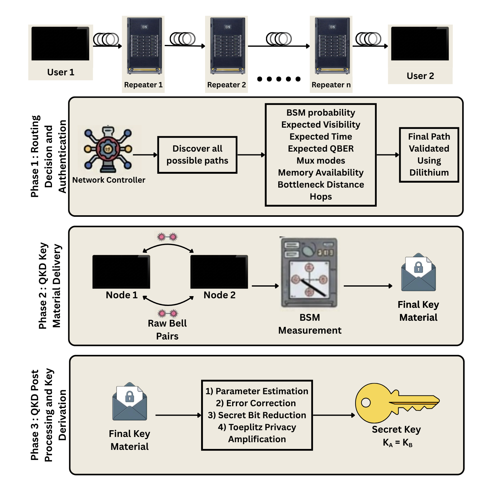
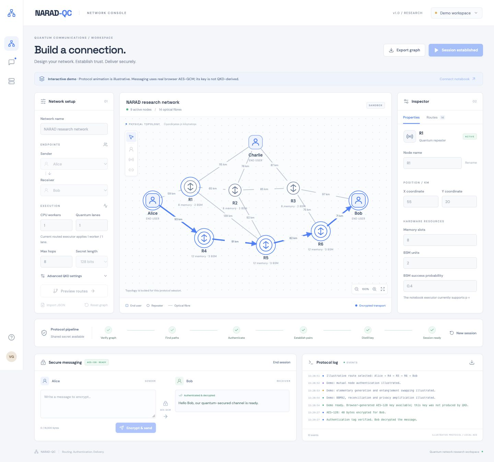

<p align="center">
  
</p>

<h1 align="center">NARAD-QC</h1>
<p align="center"><b>Network Architecture for Routing, Authentication and Delivery in Quantum Communications</b></p>
<p align="center">Design a quantum network. Find an executable route. Authenticate its nodes. Establish a shared key. Communicate securely.</p>

<p align="center">
  
  
  
  
  
</p>

---

## 📝 Overview

**How can a quantum communication network dynamically select reliable, authenticated, low-QBER paths between multiple users and repeaters?**

NARAD-QC explores this question through a resource-aware quantum-network simulator, a post-quantum-authenticated control plane, an entanglement-based key-distribution pipeline, and an interactive React console. It extends a point-to-point QKD baseline into an operator-defined network of users, optical fibres, and quantum repeaters.

A route needs more than connectivity. Its fibres must support useful entanglement generation, its repeaters need available memory and Bell-state measurement resources, and its delivered pairs must retain enough quality to produce a secret key. NARAD-QC evaluates these constraints, ranks feasible paths using an empirically calibrated service model, authenticates the selected nodes, and attempts actual simulated key establishment. If a candidate fails, the orchestrator can try the next ranked route.

The resulting key powers a **bidirectional AES-GCM session**. Alice can message Bob, and Bob can reply using the same established key. The GUI exposes the network, execution settings, protocol events, progress measurements, and encrypted message exchange in one workspace.

**Project scope:** The NARAD-QC is a software simulation. The authentication and AES routines execute cryptographic operations. This is a research implementation with physical and security-model assumptions, rather than a deployed quantum-hardware network or a production messaging service.

## 📑 Contents

- [Features](#-features)
- [System architecture](#-system-architecture)
- [Protocol walkthrough](#-protocol-walkthrough)
- [Development phases](#-development-phases)
- [Routing and physical model](#-routing-and-physical-model)
- [Interactive console](#-interactive-console)
- [Getting started](#-getting-started)
- [Running an experiment](#-running-an-experiment)
- [Parallel execution and progress](#-parallel-execution-and-progress)
- [Bidirectional messaging](#-bidirectional-messaging)
- [API integration](#-api-integration)
- [Repository structure](#-repository-structure)
- [Experiments and verification](#-experiments-and-verification)
- [Troubleshooting](#-troubleshooting)
- [Design boundaries](#-design-boundaries)
- [Author](#-author)

---

## ✨ Features

### Protocol engine

- **Operator-defined networks** with user/repeater role nodes, coordinates, active fibres, multiplexing modes, memory slots, and BSM resources.
- **Resource-aware route discovery** with repeater-only transit, hardware feasibility checks, and QKD quality constraints.
- **Routing Policy** that combines predicted service reliability, conditional pair-delivery latency, and delivered quantum-state quality.
- **ML-DSA authentication** of selected route nodes before quantum execution is authorised.
- **Discrete-event entanglement simulation** with fibre loss, finite memory, decoherence, probabilistic generation, swapping, failure recovery, and resource consumption.
- **Entanglement-based BBM92 QKD** with biased-basis measurement, sifting, parameter estimation, Cascade-style reconciliation, and Toeplitz privacy amplification.
- **Parallel routed trajectories** with separate controls for CPU workers and provisioned quantum lanes.
- **Live telemetry** for pair collection, key-yield forecasts, QBER, physical resource attempts, and applied execution capacity.

### React console

- Editable topology with draggable users/repeaters and a property inspector.
- Graph JSON import/export and a supplied [example network](gui/examples/network.json).
- Sender/receiver selection, route preview, QKD configuration, and asynchronous execution.
- Coloured directional arrows that reflect protocol stage and message direction.
- Incremental logs, downloadable traces, and reconnectable job monitoring.
- Separate composers and inboxes for both session participants.
- A standalone demo for exploring the interface before connecting Colab.

---

## 🏗️ System Architecture

<p align="center">
  
  <br><em>NARAD-QC System Flow and Architecture Diagram</em>
</p>

The notebook contains the originally developed backend engine which was later converted into a locally runnable backend engine in this git repo. The frontend does not run a quantum simulator in the browser in the demo mode. In connected mode, its protocol results come directly from the backend engine that executes the protocol. 

| Layer | Implementation |
|---|---|
| Engine and experiment environment | Local backend Python 3.12 OR Google Colab notebook |
| Physical-network simulation | Custom discrete-event kernel, quantum memory and entanglement models |
| Numerical analysis and calibration | NumPy, pandas, scikit-learn, Matplotlib |
| Route authentication | ML-DSA signature-based control plane |
| Key establishment | Biased-basis BBM92, Cascade-style reconciliation, Toeplitz hashing |
| Live GUI transport | FastAPI, Pydantic, Uvicorn, authenticated REST polling |
| Backend message encryption | AES-GCM via PyCryptodome |
| Browser demo encryption | Web Crypto AES-GCM |
| Frontend | React 19, JavaScript, SVG, CSS, Lucide icons, Vite |

---

## 🧬 Protocol Walkthrough

1. **Describe the network :** Define active USER and REPEATER nodes, coordinates, fibre properties, memory, and BSM capacity. Choose two distinct users as endpoints.
2. **Discover candidate paths :** Enumerate routes through repeaters. Users can be endpoints, but cannot act as intermediate repeaters.
3. **Apply feasibility checks :** Reject paths that fail static resource requirements or fresh-pair QKD quality constraints.
4. **Rank with Routing Policy :** Predict service reliability, delivery latency, and delivered visibility, then rank eligible candidates by useful quantum service.
5. **Authenticate the selected route :** Perform fresh ML-DSA mutual authentication of the selected nodes and enforce quantum-execution eligibility.
6. **Deliver end-to-end entanglement :** Generate elementary pairs, allocate memory, execute BSM swaps, and handle failures and expiry across the chosen heterogeneous route.
7. **Collect a BBM92 block :** Measure delivered pairs using the biased basis policy, sift outcomes and estimate errors and extractable secret length.
8. **Distill the key :** Reconcile with Cascade-style error correction, account for leakage, apply Toeplitz privacy amplification, and verify endpoint key agreement
9. **Create the secure session.** Retain the successful key on the backend and allow AES-GCM messages in either direction.

Authentication failure, infeasible resources, exhausted collection budgets, or unsuccessful distillation can prevent establishment. A routing prediction is an estimate; a session is established only after the actual execution succeeds.

## 🔬 Development Phases

The notebook records the project's progression, including earlier baselines and experiments. Later definitions and hardening cells extend or replace earlier implementations, so execution order matters.

| Phase | Purpose |
|---|---|
| **0 — Baseline** | Rebuild the point-to-point [CrypTon QKD/key-generation and AES baseline](https://github.com/Vishesh-Goyal7/CrypTon). |
| **1 — Distance effects** | Study photon attenuation, observed survival, key yield, key-generation time, and trial outcomes as distance changes. |
| **2 — Single repeater** | Compare direct transmission with repeater-assisted delivery, then introduce non-ideal fidelity and swapping. |
| **3 — Resource-aware network engine** | Introduce authenticated nodes, a discrete-event control plane, multiple repeaters, finite memory, swapping policies, decoherence, recovery, and integrated BBM92 distillation. |
| **4 — Routing and calibration** | Build an operator testbed, validate paths, calculate metrics, collect calibration trajectories, fit service models, and implement routing policy. |
| **5 — End-to-end integration** | Combine discovery, ranking, authentication, heterogeneous execution, fallback, and secret-key establishment through `narad_qc_establish_key`. |
| **6 — API exposure** | Add the notebook HTTP service and subsequent semantic, session, idempotency, access, parallel-worker, and progress updates. |
| **React console + bridge** | Expose editable topologies, live execution telemetry, directional animation, and bidirectional encrypted messaging. |

## 🧠 Routing and Physical Model

### Why shortest distance is not enough

A shorter route can still perform poorly if one fibre has low success probability, a repeater lacks memory, swapping repeatedly fails, or stored pairs lose fidelity before their neighbours become available. Adding repeaters also introduces resource and swapping costs.

Routing policy uses heterogeneous-path bottleneck features, including the longest elementary span, repeater count, and minimum multiplexed link-success probability. The calibration models estimate service success, conditional delivery latency, and delivered visibility. Its ranking follows:

$$
S_C = \frac{p_{\mathrm{service}}}{T_{\mathrm{pair}\mid\mathrm{success}}}\;U_{\mathrm{quality}}
$$

Here, quality utility measures the delivered visibility margin above the configured QKD boundary. Static hardware feasibility and delivered-QKD quality remain hard constraints. Reliability contributes continuously to the score; the current Policy C does not introduce a hard reliability admission threshold.

### What the simulator models

The engine tracks elementary entanglement generation, stored-pair lifecycles, finite memory, BSM attempts, swapping, and recovery. A Werner-state abstraction represents pair quality; waiting and composition affect the quality available at the endpoints. Multiplexing allows multiple optical modes to contribute to elementary-link generation.

These abstractions support controlled experiments. Their predictions should be interpreted within the notebook's assumptions and calibration range, rather than as measured performance of a physical deployment.

---

## 🖥️ Interactive Console

<p align="center">
  
  <br><em>Standalone interface demo. The illustrated workflow and browser-generated AES key are separate from a connected Colab execution.</em>
</p>

The console has a topology canvas, network configuration controls, a selected-node/fibre inspector, a protocol-stage strip, telemetry, participant inboxes, and a downloadable event log.

| Colour | Activity |
|---|---|
| Blue | Path discovery/routing |
| Purple | Authentication |
| Amber | Pair generation and swapping |
| Teal | Distillation |
| Green | Established session |
| Red | Failure |

Moving arrows identify activity on highlighted fibres. Replies reverse the message direction. The display samples high-frequency physical events so the interface remains usable; it is not a frame-by-frame trace of every optical attempt.

---

## 🚀 Getting Started

### Local backend / server hosting

The notebook engine is converted to a standalone Python/FastAPI service in `backend/`. It preserves the GUI API, native workers/progress, and bidirectional AES messaging. Supply fitted calibration artifacts (export once from Colab or fit locally from the raw calibration CSV), configure the environment, and run Uvicorn or the supplied Docker Compose service. Server startup requires no Colab, Drive mount, notebook execution, or tunnel.

The steps below describe the original Colab-hosted workflow.

### Prerequisites

- **Git** to download the repository.
- **Python 3.12**, including its `venv` and `pip` support.
- **Node.js 20.19+ or 22.12+**, with npm.
- A current browser.
- The project's raw routing-calibration CSV, or a trusted pre-exported model bundle as explained in Step 4.

### 1 — Clone the repository

```bash
git clone https://github.com/Vishesh-Goyal7/NARAD-QC.git
cd NARAD-QC
```

### 2 — Set up the backend environment

```bash
python3.12 -m venv backend/.venv
backend/.venv/bin/python -m pip install -r backend/requirements.lock.txt
```

This creates a project specific Python environment and required dependency modules. 

### 3 - Verify the backend is working properly

```bash
PYTHONPATH=backend backend/.venv/bin/python -m narad_backend --help
```

You should see `prepare-calibration`, `benchmark-workers`, and `serve`.

### 4 - Prepare routing models

The calibration csv files needed for this are available in the `backend/artifcats`. 

```bash
PYTHONPATH=backend backend/.venv/bin/python -m narad_backend prepare-calibration \
  --csv backend/artifacts/phase4_calibration_raw.csv \
  --output backend/artifacts/policy_c.joblib
```

This outputs 
```text
backend/artifacts/policy_c.joblib
backend/artifacts/policy_c.json
```
which is available in the artifacts folder as well. You can use these files directly or create your own. 

### 5 - Find appropriate CPU workers

This is a machine dependent operation and helps to find the number of workers your machine can support parallely. It is a very important run, so make sure you don't skip this step. 

The app initially runs in **demo mode**. You can edit a network, explore an illustrative protocol sequence, and exchange browser-encrypted messages without starting Colab. Demo routing is a local distance/multiplexing heuristic; it does not execute Policy C, ML-DSA authentication, the physical simulator, or BBM92.

First, inspect the CPU capacity available to the process:

```bash
PYTHONPATH=backend backend/.venv/bin/python -c \
  "from narad_backend.capacity import available_cpus; print('Available CPU capacity:', available_cpus())"
```
This tells you the number of CPU cores you have available. Then run the one-time benchmark:

```bash
# Example only
# Workers means number of parallel workers the run will execute
# Pairs is the number of pairs the calibration will use
# Repeats is the number of repitition for every worker
# Modes is the number of multiplexing modes you want to support
PYTHONPATH=backend backend/.venv/bin/python -m narad_backend benchmark-workers \
  --workers 1,2,4,8 --pairs 48 --repeats 1 \
  --distance-km 600 --repeaters 6 --modes 8 \
  --output backend/artifacts/workers.json
```

### 6 - Set a hard backend worker limit

The benchmark recommends a count. This step makes it an explicit backend configuration. Run the following **once**, after Step 5:

```bash
PYTHONPATH=backend backend/.venv/bin/python - <<'PY'
import json
import secrets
from pathlib import Path
from narad_backend.capacity import available_cpus

path = Path('backend/.env')
if path.exists():
    raise SystemExit('backend/.env already exists. Edit it directly; this command will not overwrite your key.')

profile = json.loads(Path('backend/artifacts/workers.json').read_text())
if not profile.get('physics_equivalent'):
    raise SystemExit('The worker benchmark did not confirm equivalent physics.')
recommended = int(profile['recommended_workers'])
if recommended < 1:
    raise SystemExit('Invalid worker recommendation.')

# Existing HTTP request contracts support up to 64 CPU workers.
cap = min(recommended, available_cpus(), 64)
path.write_text(
    'NARAD_API_ACCESS_KEY=' + secrets.token_urlsafe(32) + '\n'
    'NARAD_ALLOWED_ORIGINS=http://127.0.0.1:5173,http://localhost:5173\n'
    'NARAD_CALIBRATION_PATH=backend/artifacts/policy_c.joblib\n'
    'NARAD_WORKER_PROFILE=backend/artifacts/workers.json\n'
    f'NARAD_CONTROLLER_MAX_CPU_WORKERS={cap}\n'
)
path.chmod(0o600)
print(f'Created backend/.env with a hard CPU-worker cap of {cap}.')
print('Your private API key is stored in that file.')
PY
```

This creates `backend/.env` with a random API key, local frontend origins, model/profile paths, and an explicit cap. 
The hard-limit setting looks like this:

```dotenv
# Example: replace 4 with your chosen count, up to the recommended capacity.
NARAD_CONTROLLER_MAX_CPU_WORKERS=4
```
You can change the number of workers if you want.

### 7 - Start the backend — Terminal 1

Make sure Terminal 1 is at the repository root, then run:

```bash
set -a && source backend/.env && set +a

PYTHONPATH=backend backend/.venv/bin/python -m narad_backend serve \
  --host 127.0.0.1 --port 8002
```

`source` loads your settings into the current terminal, and `set -a` exports them to the Python process. The backend does not automatically load `.env`. Only source your own trusted environment file.

Wait for application startup and the Uvicorn listening message. Leave this terminal running.

In your browser, open:

```text
http://127.0.0.1:8002/health
http://127.0.0.1:8002/ready
```

The first confirms the service is alive; the second should report `ready: true` and its controller worker limit. These checks do not launch QKD.

GUI API documentation is at `http://127.0.0.1:8002/docs`. The React app uses `/gui` endpoints automatically.

### 8 - Install and run the frontend — Terminal 2

Open a second terminal. Navigate to the same repository directory; for example, if you cloned under your home directory:

```bash
cd /NARAD-QC
npm --prefix gui ci
npm --prefix gui run dev -- --port 5173 --strictPort
```

The first command installs the frontend packages using its lockfile. The second starts React at a fixed port. `--strictPort` prevents Vite from silently changing to an origin your backend has not allowed.

Open:

```text
http://127.0.0.1:5173
```

Keep Terminal 2 running as well. Both terminals are needed while testing.

### 9 - Connect the frontend to the backend

1. In the React app, choose **Demo Workspace**. The label also applies to the standalone server; no notebook needs to be running.
2. Enter **`http://127.0.0.1:8002`** as the backend URL. Use the base URL without `/gui`, `/api`, or `/docs` or any other extensions.
3. Open your local `backend/.env` in a text editor. Copy only the value after `NARAD_API_ACCESS_KEY=` into the API-key field.
4. Select **Test & connect**.
5. Confirm the app shows a connected backend and reports worker capacity.

The API key authorises the research operator. Keep it private and out of committed files. If you restart with a different key, reconnect using the new value.

Until this connection succeeds, the frontend remains in its labelled **demo mode**. Demo animations and demo-generated keys do not prove that the backend protocol ran.

### 10. Troubleshooting

| Problem | Action |
|---|---|
| `python3.12` or `node` is missing | Install the required prerequisite and reopen your terminal. |
| Dependency installation fails | Confirm Python 3.12 and a supported OS; use the pinned backend lockfile. Follow any specific missing-library error from the installer. |
| `No module named narad_backend` | Run from the repository root and include `PYTHONPATH=backend` exactly as shown. |
| `Missing fitted Policy C artifact` | Complete Step 5 and verify both model files exist at the configured path. |
| Calibration CSV is missing | Obtain it from the linked Drive resources or maintainer; a fresh clone does not include it. |
| Model version/checksum mismatch | Refit from the original CSV in the pinned environment, or use the matching version and complete model/JSON pair from a trusted export. |
| Worker report is missing | Complete Step 6, or remove the profile setting and explicitly configure a conservative cap of 1 until benchmarking. |
| More workers requested than available | Use the capacity command from Step 6 and choose counts within it. |
| Applied workers are fewer than requested | Check the hard cap, available CPU quota/affinity, quantum lanes, and any process-farm fallback. |
| Server rejects API-key configuration | Generate a private random key; it must be at least 24 characters. Load `.env` in the same terminal that starts the backend. |
| Frontend returns `401 Unauthorized` | Recopy the exact current key value, without `NARAD_API_ACCESS_KEY=` or surrounding whitespace. |
| Port 5173 or 8002 is already in use | Stop the conflicting development server or choose another port and update the frontend URL/CORS configuration accordingly. |
| CORS failure | `NARAD_ALLOWED_ORIGINS` must include the frontend's exact scheme, hostname, and port. Restart the backend after editing `.env`. |
| Frontend stays in demo mode | Complete Test & connect; opening React alone does not connect the engine. |
| No feasible route / establishment fails | Check active links, endpoint roles, memory, BSM settings, quality constraints, and pair budget. Begin with the supplied first-run chain. |
| Forecast is full but messaging is disabled | Wait for actual successful key distillation and session creation; inspect logs for post-processing failure. |
| Shutdown takes time | An active protocol job may still be finishing. Avoid treating a process restart as resumable simulation cancellation. |

---

## 🧪 Running an Experiment

1. **Create or import a graph.** Begin with the supplied topology or import [`gui/examples/network.json`](gui/examples/network.json).
2. **Place users and repeaters.** Drag nodes or edit their kilometre coordinates. Fibre lengths follow Euclidean distance between endpoints.
3. **Configure resources.** Set repeater memory slots and BSM properties, then fibre activity, attenuation, and optical multiplexing modes.
4. **Choose endpoints.** Select two distinct active USER nodes. Other users cannot be transit nodes.
5. **Set the execution budget.** Choose CPU workers, quantum lanes, maximum hops, target secret length, and available advanced QKD settings.
6. **Preview routes.** Connected mode evaluates the submitted graph through Policy C. Selecting a preview highlights it; the orchestrator chooses and falls back between ranked candidates during execution.
7. **Run the protocol.** The submitted graph/configuration is frozen for the asynchronous job. Follow stage changes, telemetry, arrows, and logs.
8. **Exchange messages.** After establishment, send from either participant's composer and verify/decrypt at the other participant's inbox.
9. **Export or end.** Download the graph/logs as needed. End the session before editing the topology for another run.

A preview does not reserve resources or guarantee success. If monitoring loses its connection, use **Resume monitor** for the existing job instead of starting another establishment.

## ⚙️ Parallel Execution and Progress

### CPU workers, quantum lanes, and optical modes

| Setting | Meaning |
|---|---|
| **CPU workers** | Python worker processes used to calculate independent routed trajectories. |
| **Quantum lanes** | Independent provisioned route trajectories in the simulated physical execution. |
| **Optical modes** | Multiplexed elementary-generation opportunities on a physical fibre. |

These are separate controls. More CPU workers can speed computation; changing quantum lanes changes the modeled concurrent physical provision. Applied CPU workers are bounded by requested workers, lane count, runtime logical CPUs, and the controller limit. A single causal lane uses one worker. If the process farm falls back to direct execution, the applied worker count can drop while the requested physical lanes remain unchanged.

The bridge serializes establishment sessions through one controller thread. Parallel CPU work happens **within** the active session; selecting four workers does not mean four unrelated GUI sessions execute concurrently.

### Reading the telemetry

| Measurement | Interpretation |
|---|---|
| Forecast secret yield | Estimated extractable bits relative to the requested secret length. |
| Pair budget used | Delivered-pair count relative to the maximum collection budget. |
| ZZ / XX counts | Key-basis and estimation-basis sample counts. |
| Observed X QBER | Error observed in the available X-basis sample; unavailable before there are suitable samples. |
| Applied workers / lanes | Actual execution capacity reported by the runtime. |
| Modeled physical time | Time inside the simulation, distinct from wall-clock computation time. |

**Forecast 100% is not a completed session.** Reconciliation and privacy amplification must still succeed. Pair-budget usage is consumption, not a whole-protocol completion percentage. The GUI waits for a successful server session before enabling messaging.

## 🔐 Bidirectional Messaging

The sender/receiver selected for establishment identifies the participant pair. It does not restrict the resulting session to one-way use.

```text
Alice composer ── AES-GCM / shared session key ──► Bob inbox
Alice inbox    ◄── AES-GCM / same session key ─── Bob composer
```

Both directions use **one established key and one session ID**. Each encryption receives a distinct 96-bit nonce: a random four-byte session prefix followed by an increasing 64-bit counter. The backend allocates this counter under a session lock, across both directions, so concurrent Alice/Bob sends do not reuse a nonce.

The bridge validates the participant pair and rejects self-send and third-party sender/receiver combinations. Inbox entries preserve the actual direction. AES-GCM authentication detects modified ciphertext packages, and plaintext is returned through the decrypt operation after verification.

The shared key stays on the backend in connected mode. The browser demo instead generates a non-extractable Web Crypto key and maintains its own shared nonce counter. Sessions are held in memory, expire according to the notebook's configured TTL, and can be explicitly destroyed.

The console presents both peers to a notebook operator. It does not provide separate user accounts, independently authenticated recipient devices, or an end-to-end encrypted transport that hides plaintext from the backend operator.

---

## 🔌 API Integration

The engine's main Python entry point is `narad_qc_establish_key(...)`. The latest wrapper adds `cpu_workers`, `parallel_quantum_lanes`, `progress_callback`, and `execution_audit` around the existing establishment flow.

The GUI uses these protected bridge routes:

| Method | Route | Purpose |
|---|---|---|
| GET | `/gui/health` | Readiness, bridge version, and capabilities |
| GET | `/gui/runtime/capacity` | CPU/controller limits and supported execution options |
| POST | `/gui/preview` | Validate submitted topology and rank candidate routes |
| POST | `/gui/jobs` | Submit an asynchronous establishment job |
| GET | `/gui/jobs/{id}?after={cursor}` | Status, incremental events, telemetry, and public result |
| POST | `/gui/sessions/{id}/messages` | Encrypt/enqueue a message in either direction |
| GET | `/gui/sessions/{id}/messages?after={index}` | Fetch ciphertext deliveries |
| POST | `/gui/sessions/{id}/decrypt` | Authenticate and decrypt a message package |
| DELETE | `/gui/sessions/{id}` | Destroy the session and inbox |

Operational requests require `X-NARAD-API-Key`. Establishment submissions include a caller-generated `request_id`: retrying the same request reuses its job; changing the payload under the same ID returns a conflict. Public job/event payloads exclude raw secret-key material and raw QKD bits.

See [the payload example and API notes](gui/README.md#live-bridge-routes) for independent client integration. The notebook's legacy message handler is separate; the bidirectional inbox behavior described here belongs to the GUI bridge endpoints.

## 📊 Experiments and Verification

The repository preserves research outputs across several stages. These outputs belong to their individual experiment configurations. Earlier-phase plots are not automatically benchmarks of the latest routed GUI execution. Consult the accompanying configuration and raw/summary files when comparing results.

## Run the GUI checks

```bash
npm --prefix gui test
npm --prefix gui run build

python3 -m venv gui/.venv
gui/.venv/bin/python -m pip install -r gui/backend/requirements.txt
gui/.venv/bin/python -m unittest discover -s gui/backend/tests -v
```

On Windows, use `gui\.venv\Scripts\python.exe` in place of `gui/.venv/bin/python`.

The recorded **19 October 2026** verification includes **9 frontend tests**, **15 backend integration tests**, a production build, and browser checks for native telemetry and Alice ↔ Bob messaging. Tests cover graph constraints, progress interpretation, worker forwarding/fallback, fork-safe observers, authentication boundaries, idempotency, AES tamper detection, expiry, and concurrent nonce uniqueness.

Backend integration and browser transport checks use fixture quantum trajectories with actual AES-GCM. They do not replace a fresh complete physical/QKD run in Colab. See the [GUI verification instructions](gui/README.md#verification) to reproduce the local checks.

## 🙋‍♂️ Author

NARAD-QC grew from the question of how to take a working point-to-point quantum-key experiment and turn it into a network that must choose routes, manage finite resources, authenticate its nodes, and still deliver enough useful entanglement to communicate.

If the project helped you explore quantum networking, inspired an experiment, made you think, or raised a useful question, feel free to ⭐ the repository and get in touch. And until next time, stay curious.

**Vishesh Goyal**  
[Mail](mailto:visheshvishu1@outlook.com) 
[GitHub](https://github.com/Vishesh-Goyal7) 
[LinkedIn](https://www.linkedin.com/in/vishesh-goyal-2k5) 
[Portfolio](https://visheshverse.com)

---

<p align="center">Developed by <a href="https://visheshverse.com">VisheshVerse</a></p>
