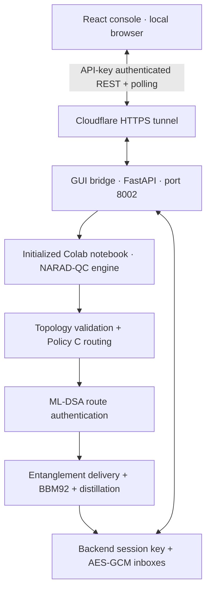

<p align="center">
  
</p>

<h1 align="center">NARAD-QC</h1>
<p align="center"><b>Network Architecture for Routing, Authentication and Delivery in Quantum Communications</b></p>
<p align="center">Design a quantum network. Find an executable route. Authenticate its nodes. Establish a shared key. Communicate securely.</p>

<p align="center">
  
  
  
  
  
</p>

---

## 📝 Overview

**How can a quantum communication network dynamically select reliable, authenticated, low-QBER paths between multiple users and repeaters?**

NARAD-QC explores this question through a resource-aware quantum-network simulator, a post-quantum-authenticated control plane, an entanglement-based key-distribution pipeline, and an interactive React console. It extends a point-to-point QKD baseline into an operator-defined network of users, optical fibres, and quantum repeaters.

A route needs more than connectivity. Its fibres must support useful entanglement generation, its repeaters need available memory and Bell-state measurement resources, and its delivered pairs must retain enough quality to produce a secret key. NARAD-QC evaluates these constraints, ranks feasible paths using an empirically calibrated service model, authenticates the selected nodes, and attempts actual simulated key establishment. If a candidate fails, the orchestrator can try the next ranked route.

The resulting key powers a **bidirectional AES-GCM session**: Alice can message Bob, and Bob can reply using the same established key. The GUI exposes the network, execution settings, protocol events, progress measurements, and encrypted message exchange in one workspace.

**Project scope:** the quantum network is a software simulation; the authentication and AES routines execute cryptographic operations. This is a research implementation with physical and security-model assumptions, rather than a deployed quantum-hardware network or a production messaging service.

## 📑 Contents

- [Features](#-features)
- [System architecture](#-system-architecture)
- [Protocol walkthrough](#-protocol-walkthrough)
- [Development phases](#-development-phases)
- [Routing and physical model](#-routing-and-physical-model)
- [Interactive console](#-interactive-console)
- [Getting started](#-getting-started)
- [Running an experiment](#-running-an-experiment)
- [Parallel execution and progress](#-parallel-execution-and-progress)
- [Bidirectional messaging](#-bidirectional-messaging)
- [API integration](#-api-integration)
- [Repository structure](#-repository-structure)
- [Experiments and verification](#-experiments-and-verification)
- [Troubleshooting](#-troubleshooting)
- [Design boundaries](#-design-boundaries)
- [Author](#-author)

---

## ✨ Features

### Protocol engine

- **Operator-defined networks** with user/repeater roles, coordinates, active fibres, multiplexing modes, memory slots, and BSM resources.
- **Resource-aware route discovery** with repeater-only transit, hardware feasibility checks, and QKD quality constraints.
- **Policy C routing** that combines predicted service reliability, conditional pair-delivery latency, and delivered quantum-state quality.
- **ML-DSA authentication** of selected route nodes before quantum execution is authorized.
- **Discrete-event entanglement simulation** with fibre loss, finite memory, decoherence, probabilistic generation, swapping, failure recovery, and resource consumption.
- **Entanglement-based BBM92 QKD** with biased-basis measurement, sifting, parameter estimation, Cascade-style reconciliation, and Toeplitz privacy amplification.
- **Parallel routed trajectories** with separate controls for CPU workers and provisioned quantum lanes.
- **Live telemetry** for pair collection, key-yield forecasts, QBER, physical resource attempts, and applied execution capacity.

### React console

- Editable SVG topology with draggable users/repeaters and a property inspector.
- Graph JSON import/export and a supplied [example network](gui/examples/network.json).
- Sender/receiver selection, route preview, QKD configuration, and asynchronous execution.
- Coloured directional arrows that reflect protocol stage and message direction.
- Incremental logs, downloadable traces, and reconnectable job monitoring.
- Separate composers and inboxes for both session participants.
- A standalone demo for exploring the interface before connecting Colab.

---

## 🏗️ System Architecture



The notebook contains the engine and its original Phase 6 API. The React console uses a **separate GUI bridge** that adds custom-topology submission, asynchronous jobs, incremental events, native progress, and two-way inboxes. The bridge runs inside the initialized notebook runtime and calls the engine's Python objects directly.

The frontend does not run a quantum simulator in the browser. In connected mode, its protocol results come from the notebook. The bridge stores the session key on the backend and exposes public summaries and ciphertext deliveries to the console.

| Layer | Implementation |
|---|---|
| Engine and experiment environment | Python / Google Colab, `NARAD_QC.ipynb` |
| Physical-network simulation | Custom discrete-event kernel, quantum memory and entanglement models |
| Numerical analysis and calibration | NumPy, pandas, scikit-learn, Matplotlib |
| Route authentication | ML-DSA signature-based control plane |
| Key establishment | Biased-basis BBM92, Cascade-style reconciliation, Toeplitz hashing |
| Live GUI transport | FastAPI, Pydantic, Uvicorn, authenticated REST polling |
| Backend message encryption | AES-GCM via PyCryptodome |
| Browser demo encryption | Web Crypto AES-GCM |
| Frontend | React 19, JavaScript, SVG, CSS, Lucide icons, Vite |
| Colab connectivity | Cloudflare tunnel to the GUI bridge |

---

## 🧬 Protocol Walkthrough

1. **Describe the network.** Define active USER and REPEATER nodes, coordinates, fibre properties, memory, and BSM capacity. Choose two distinct users as endpoints.
2. **Discover candidate paths.** Enumerate routes through repeaters. Users can be endpoints, but cannot act as intermediate repeaters.
3. **Apply feasibility checks.** Reject paths that fail static resource requirements or fresh-pair QKD quality constraints.
4. **Rank with Policy C.** Predict service reliability, delivery latency, and delivered visibility, then rank eligible candidates by useful quantum service.
5. **Authenticate the selected route.** Perform fresh ML-DSA mutual authentication of the selected nodes and enforce quantum-execution eligibility.
6. **Deliver end-to-end entanglement.** Generate elementary pairs, allocate memory, execute BSM swaps, and handle failures and expiry across the chosen heterogeneous route.
7. **Collect a BBM92 block.** Measure delivered pairs using the biased basis policy; sift outcomes and estimate errors and extractable secret length.
8. **Distill the key.** Reconcile with Cascade-style error correction, account for leakage, apply Toeplitz privacy amplification, and verify endpoint key agreement.
9. **Create the secure session.** Retain the successful key on the backend and allow AES-GCM messages in either direction.

Authentication failure, infeasible resources, exhausted collection budgets, or unsuccessful distillation can prevent establishment. A routing prediction is an estimate; a session is established only after the actual execution succeeds.

## 🔬 Development Phases

The notebook records the project's progression, including earlier baselines and experiments. Later definitions and hardening cells extend or replace earlier implementations, so execution order matters.

| Phase | Purpose |
|---|---|
| **0 — Baseline** | Rebuild the point-to-point CrypTon QKD/key-generation and AES baseline. |
| **1 — Distance effects** | Study photon attenuation, observed survival, key yield, key-generation time, and trial outcomes as distance changes. |
| **2 — Single repeater** | Compare direct transmission with repeater-assisted delivery, then introduce non-ideal fidelity and swapping. |
| **3 — Resource-aware network engine** | Introduce authenticated nodes, a discrete-event control plane, multiple repeaters, finite memory, swapping policies, decoherence, recovery, and integrated BBM92 distillation. |
| **4 — Routing and calibration** | Build an operator testbed, validate paths, calculate metrics, collect calibration trajectories, fit service models, and implement Policy C. |
| **5 — End-to-end integration** | Combine discovery, ranking, authentication, heterogeneous execution, fallback, and secret-key establishment through `narad_qc_establish_key`. |
| **6 — API exposure** | Add the notebook HTTP service and subsequent semantic, session, idempotency, access, parallel-worker, and progress updates. |
| **React console + bridge** | Expose editable topologies, live execution telemetry, directional animation, and bidirectional encrypted messaging. |

## 🧠 Routing and Physical Model

### Why shortest distance is not enough

A shorter route can still perform poorly if one fibre has low success probability, a repeater lacks memory, swapping repeatedly fails, or stored pairs lose fidelity before their neighbours become available. Adding repeaters also introduces resource and swapping costs.

Policy C uses heterogeneous-path bottleneck features, including the longest elementary span, repeater count, and minimum multiplexed link-success probability. The calibration models estimate service success, conditional delivery latency, and delivered visibility. Its ranking follows:

$$
S_C = \frac{p_{\mathrm{service}}}{T_{\mathrm{pair}\mid\mathrm{success}}}\;U_{\mathrm{quality}}
$$

Here, quality utility measures the delivered visibility margin above the configured QKD boundary. Static hardware feasibility and delivered-QKD quality remain hard constraints. Reliability contributes continuously to the score; the current Policy C does not introduce a hard reliability admission threshold.

### What the simulator models

The engine tracks elementary entanglement generation, stored-pair lifecycles, finite memory, BSM attempts, swapping, and recovery. A Werner-state abstraction represents pair quality; waiting and composition affect the quality available at the endpoints. Multiplexing allows multiple optical modes to contribute to elementary-link generation.

These abstractions support controlled experiments. Their predictions should be interpreted within the notebook's assumptions and calibration range, rather than as measured performance of a physical deployment.

---

## 🖥️ Interactive Console

<p align="center">
  
  <br><em>Standalone interface demo. The illustrated workflow and browser-generated AES key are separate from a connected Colab execution.</em>
</p>

The console has a topology canvas, network configuration controls, a selected-node/fibre inspector, a protocol-stage strip, telemetry, participant inboxes, and a downloadable event log.

| Colour | Activity |
|---|---|
| Blue | Path discovery/routing |
| Purple | Authentication |
| Amber | Pair generation and swapping |
| Teal | Distillation |
| Green | Established session |
| Red | Failure |

Moving arrows identify activity on highlighted fibres. Replies reverse the message direction. The display samples high-frequency physical events so the interface remains usable; it is not a frame-by-frame trace of every optical attempt.

---

## 🚀 Getting Started

### Prerequisites

- A Google account and access to Google Colab for the notebook engine.
- **Node.js 20.19+ or 22.12+** with npm for the Vite frontend.
- The project's Drive datasets/checkpoints where required by the notebook's calibration and collection cells.
- A browser with Web Crypto support for standalone demo messaging; localhost is suitable.
- Python and the bridge requirements only if running backend tests locally. Colab supplies the notebook Python runtime.

The Colab notebook and Google Drive resource links are provided separately in this repository's GitHub links/About area. The notebook source is also included here as [`NARAD_QC.ipynb`](NARAD_QC.ipynb).

### 1 — Clone the repository

```bash
git clone https://github.com/Vishesh-Goyal7/NARAD-QC.git
cd NARAD-QC
```

### 2 — Start the React console

```bash
npm --prefix gui ci
npm --prefix gui run dev
```

Open the local URL printed by Vite, normally **http://127.0.0.1:5173**.

The app initially runs in **demo mode**. You can edit a network, explore an illustrative protocol sequence, and exchange browser-encrypted messages without starting Colab. Demo routing is a local distance/multiplexing heuristic; it does not execute Policy C, ML-DSA authentication, the physical simulator, or BBM92.

### 3 — Initialize the notebook engine in Colab

1. Open a copy of `NARAD_QC.ipynb` in Colab and connect a runtime.
2. Run the notebook's dependency installation and initialization cells in their intended order.
3. Mount Google Drive when the notebook requests it. Make the linked resource files available at the paths used by the notebook, or adjust those paths to your own Drive layout.
4. Initialize the Phase 3 engine and Phase 4 calibration/model dependencies, then the Phase 5 orchestrator and Phase 6 definitions/hardening cells.
5. Run **Runtime Parallelism + Live QKD Telemetry** and **API Worker + Progress Wiring** before installing the GUI bridge.

**Calibration prerequisite:** Policy C needs fitted models in the current Python runtime. The notebook can use an in-memory raw calibration dataframe or read `phase4_calibration_raw.csv`, normally from:

```text
/content/drive/MyDrive/NARAD_QC/checkpoints/
└── phase4_routing_calibration/
    └── phase4_calibration_raw.csv
```

Execute the associated dataset preparation, model-fitting, reliability calibration, and predictor definitions. The relevant final runtime objects include `PHASE4_FINAL_LATENCY_MODEL`, `PHASE4_FINAL_VISIBILITY_MODEL`, `PHASE4_FINAL_RELIABILITY_MODEL`, and `PHASE4_FINAL_RELIABILITY_CALIBRATOR`.

The notebook contains long-running Monte Carlo studies and historical/commented demonstration cells. Running an experiment is separate from initializing its definitions. If saved calibration data is unavailable, generating it is an additional workload; simply starting the HTTP server does not reconstruct missing models.

### 4 — Install the GUI bridge inside Colab

Install its transport dependencies in a Colab cell:

```python
%pip install 'fastapi>=0.115,<1' 'pydantic>=2.9,<3' 'uvicorn>=0.30,<1'
```

The initialized notebook must also provide its cryptographic and numerical dependencies.

Upload [`gui/backend/gui_bridge.py`](gui/backend/gui_bridge.py) to:

```text
/content/drive/MyDrive/NARAD_QC/gui_bridge.py
```

Alternatively, upload it to `/content/gui_bridge.py`. The supplied bootstrap prefers the Drive copy when both exist.

Copy the contents of [`gui/backend/colab_cell.py`](gui/backend/colab_cell.py) into a Colab cell **after the initialization and parallel/progress cells**, then run it. It starts the GUI bridge on **127.0.0.1:8002** and prints its version. The current bridge version is **1.1.0**.

This bridge needs the notebook's live Python namespace. Starting the bridge file as an independent server does not initialize quantum physics or calibration models. The original Phase 6 HTTP server is optional for GUI use.

### 5 — Expose the bridge with a tunnel

Use the notebook's cloudflared installation, then run in another Colab cell:

```python
!cloudflared tunnel --url http://127.0.0.1:8002
```

Keep the tunnel running and copy its generated HTTPS URL. Use the tunnel for **port 8002**, rather than a tunnel pointing at the notebook's legacy API port. Temporary tunnel URLs change when recreated.

### 6 — Connect React to Colab

1. Open **Connect notebook** in the console.
2. Enter the tunnel's base HTTPS URL, without appending `/gui`.
3. Enter the notebook runtime's `NARAD_API_ACCESS_KEY`.
4. Select **Test & connect**.
5. Confirm the connection, preview a route, and run the protocol.

The console sends the access key in `X-NARAD-API-Key`. It retains it in tab memory, rather than saving it in localStorage, graph exports, or source files.

For more transport details, custom frontend origins, and local-kernel integration, see the [GUI implementation guide](gui/README.md).

### 7 — Build the frontend for hosting

```bash
npm --prefix gui run build
npm --prefix gui run preview
```

The static build is emitted to `gui/dist`. If hosting on a different origin, configure that exact origin when installing the bridge:

```python
NARAD_GUI_APP = _bridge.install_gui_bridge(
    globals(),
    allowed_origins=["https://your-console.example"]
)
```

The defaults allow localhost/127.0.0.1 on development port 5173 and preview port 4173. The tunnel URL is entered at runtime, so a rotated Colab URL does not require rebuilding React.

---

## 🧪 Running an Experiment

1. **Create or import a graph.** Begin with the supplied topology or import [`gui/examples/network.json`](gui/examples/network.json).
2. **Place users and repeaters.** Drag nodes or edit their kilometre coordinates. Fibre lengths follow Euclidean distance between endpoints.
3. **Configure resources.** Set repeater memory slots and BSM properties, then fibre activity, attenuation, and optical multiplexing modes.
4. **Choose endpoints.** Select two distinct active USER nodes. Other users cannot be transit nodes.
5. **Set the execution budget.** Choose CPU workers, quantum lanes, maximum hops, target secret length, and available advanced QKD settings.
6. **Preview routes.** Connected mode evaluates the submitted graph through Policy C. Selecting a preview highlights it; the orchestrator chooses and falls back between ranked candidates during execution.
7. **Run the protocol.** The submitted graph/configuration is frozen for the asynchronous job. Follow stage changes, telemetry, arrows, and logs.
8. **Exchange messages.** After establishment, send from either participant's composer and verify/decrypt at the other participant's inbox.
9. **Export or end.** Download the graph/logs as needed. End the session before editing the topology for another run.

A preview does not reserve resources or guarantee success. If monitoring loses its connection, use **Resume monitor** for the existing job instead of starting another establishment.

## ⚙️ Parallel Execution and Progress

### CPU workers, quantum lanes, and optical modes

| Setting | Meaning |
|---|---|
| **CPU workers** | Python worker processes used to calculate independent routed trajectories. |
| **Quantum lanes** | Independent provisioned route trajectories in the simulated physical execution. |
| **Optical modes** | Multiplexed elementary-generation opportunities on a physical fibre. |

These are separate controls. More CPU workers can speed computation; changing quantum lanes changes the modeled concurrent physical provision. Applied CPU workers are bounded by requested workers, lane count, runtime logical CPUs, and the controller limit. A single causal lane uses one worker. If the process farm falls back to direct execution, the applied worker count can drop while the requested physical lanes remain unchanged.

The bridge serializes establishment sessions through one controller thread. Parallel CPU work happens **within** the active session; selecting four workers does not mean four unrelated GUI sessions execute concurrently.

### Reading the telemetry

| Measurement | Interpretation |
|---|---|
| Forecast secret yield | Estimated extractable bits relative to the requested secret length. |
| Pair budget used | Delivered-pair count relative to the maximum collection budget. |
| ZZ / XX counts | Key-basis and estimation-basis sample counts. |
| Observed X QBER | Error observed in the available X-basis sample; unavailable before there are suitable samples. |
| Applied workers / lanes | Actual execution capacity reported by the runtime. |
| Modeled physical time | Time inside the simulation, distinct from wall-clock computation time. |

**Forecast 100% is not a completed session.** Reconciliation and privacy amplification must still succeed. Pair-budget usage is consumption, not a whole-protocol completion percentage. The GUI waits for a successful server session before enabling messaging.

## 🔐 Bidirectional Messaging

The sender/receiver selected for establishment identifies the participant pair. It does not restrict the resulting session to one-way use.

```text
Alice composer ── AES-GCM / shared session key ──► Bob inbox
Alice inbox    ◄── AES-GCM / same session key ─── Bob composer
```

Both directions use **one established key and one session ID**. Each encryption receives a distinct 96-bit nonce: a random four-byte session prefix followed by an increasing 64-bit counter. The backend allocates this counter under a session lock, across both directions, so concurrent Alice/Bob sends do not reuse a nonce.

The bridge validates the participant pair and rejects self-send and third-party sender/receiver combinations. Inbox entries preserve the actual direction. AES-GCM authentication detects modified ciphertext packages, and plaintext is returned through the decrypt operation after verification.

The shared key stays on the backend in connected mode. The browser demo instead generates a non-extractable Web Crypto key and maintains its own shared nonce counter. Sessions are held in memory, expire according to the notebook's configured TTL, and can be explicitly destroyed.

The console presents both peers to a notebook operator. It does not provide separate user accounts, independently authenticated recipient devices, or an end-to-end encrypted transport that hides plaintext from the backend operator.

---

## 🔌 API Integration

The engine's main Python entry point is `narad_qc_establish_key(...)`. The latest wrapper adds `cpu_workers`, `parallel_quantum_lanes`, `progress_callback`, and `execution_audit` around the existing establishment flow.

The GUI uses these protected bridge routes:

| Method | Route | Purpose |
|---|---|---|
| GET | `/gui/health` | Readiness, bridge version, and capabilities |
| GET | `/gui/runtime/capacity` | CPU/controller limits and supported execution options |
| POST | `/gui/preview` | Validate submitted topology and rank candidate routes |
| POST | `/gui/jobs` | Submit an asynchronous establishment job |
| GET | `/gui/jobs/{id}?after={cursor}` | Status, incremental events, telemetry, and public result |
| POST | `/gui/sessions/{id}/messages` | Encrypt/enqueue a message in either direction |
| GET | `/gui/sessions/{id}/messages?after={index}` | Fetch ciphertext deliveries |
| POST | `/gui/sessions/{id}/decrypt` | Authenticate and decrypt a message package |
| DELETE | `/gui/sessions/{id}` | Destroy the session and inbox |

Operational requests require `X-NARAD-API-Key`. Establishment submissions include a caller-generated `request_id`: retrying the same request reuses its job; changing the payload under the same ID returns a conflict. Public job/event payloads exclude raw secret-key material and raw QKD bits.

See [the payload example and API notes](gui/README.md#live-bridge-routes) for independent client integration. The notebook's legacy message handler is separate; the bidirectional inbox behavior described here belongs to the GUI bridge endpoints.

## 🗂️ Repository Structure

```text
NARAD-QC/
├── NARAD_QC.ipynb                  # Engine, experiments, calibration, orchestration, API
├── README.md                      # Project overview and implementation guide
├── Docs/
│   └── NARAD-QC Logo.png
├── Phase 1 Outputs/               # Distance effects: CSVs, Monte Carlo results, plots
├── Phase 2A Outputs/              # Direct versus single-repeater experiments
├── Phase 2B Outputs/              # Repeater-assisted key-generation output
├── Phase 2C Outputs/              # Non-ideal single-repeater / basis-policy studies
├── Phase 3/
│   ├── Distance_Separation/        # Distance study: configs, trials, summaries, plots
│   └── Repeater_Density/           # Repeater-count study and resource metrics
├── References/                    # Research PDFs used during development
└── gui/
    ├── README.md                  # Detailed GUI/bridge integration notes
    ├── examples/network.json      # Importable topology
    ├── src/
    │   ├── App.jsx                # Console state, jobs, canvas and workflow
    │   ├── Telemetry.jsx          # Native progress and applied execution metrics
    │   ├── PeerMessaging.jsx      # Two participant composers and inboxes
    │   ├── api.js                 # Bridge HTTP client
    │   ├── graph.js               # Graph operations and validation
    │   ├── progress.js            # Progress interpretation and demo nonce allocation
    │   └── styles.css             # Responsive console styling
    ├── backend/
    │   ├── gui_bridge.py          # FastAPI adapter inside the notebook runtime
    │   ├── colab_cell.py          # Bootstrap / idle bridge replacement
    │   ├── requirements.txt       # Bridge and local-test dependencies
    │   └── tests/                 # HTTP, execution, telemetry and AES tests
    ├── package.json
    └── package-lock.json
```

## 📊 Experiments and Verification

The repository preserves research outputs across several stages:

| Study | Artifacts |
|---|---|
| Distance-dependent direct transmission | [Phase 1 outputs](Phase%201%20Outputs/) |
| Direct versus single-repeater delivery | [Phase 2A outputs](Phase%202A%20Outputs/) |
| Repeater-assisted key generation | [Phase 2B outputs](Phase%202B%20Outputs/) |
| Non-ideal swapping and basis-policy sweeps | [Phase 2C outputs](Phase%202C%20Outputs/) |
| Multi-repeater distance separation | [Phase 3 distance study](Phase%203/Distance_Separation/) |
| Repeater density and resource demand | [Phase 3 repeater study](Phase%203/Repeater_Density/) |

These outputs belong to their individual experiment configurations. Earlier-phase plots are not automatically benchmarks of the latest routed GUI execution. Consult the accompanying configuration and raw/summary files when comparing results.

### Run the GUI checks

```bash
npm --prefix gui test
npm --prefix gui run build

python3 -m venv gui/.venv
# macOS / Linux
gui/.venv/bin/python -m pip install -r gui/backend/requirements.txt
gui/.venv/bin/python -m unittest discover -s gui/backend/tests -v
```

On Windows, use `gui\.venv\Scripts\python.exe` in place of `gui/.venv/bin/python`.

The recorded **19 October 2026** verification includes **9 frontend tests**, **15 backend integration tests**, a production build, and browser checks for native telemetry and Alice ↔ Bob messaging. Tests cover graph constraints, progress interpretation, worker forwarding/fallback, fork-safe observers, authentication boundaries, idempotency, AES tamper detection, expiry, and concurrent nonce uniqueness.

Backend integration and browser transport checks use fixture quantum trajectories with actual AES-GCM. They do not replace a fresh complete physical/QKD run in Colab. See the [GUI verification instructions](gui/README.md#verification) to reproduce the local checks.

## 🛠️ Troubleshooting

| Symptom | What to check |
|---|---|
| Console remains in demo mode | Open Connect notebook, supply the current bridge tunnel URL and runtime access key, then test the connection. |
| Unauthorized response | Use the current runtime's `NARAD_API_ACCESS_KEY`; restarting Colab can invalidate the previous runtime state. |
| Bridge cannot find notebook objects | Initialize the required engine, fitted calibration models, orchestrator, and later patches before running the bootstrap. |
| Missing calibration CSV | Mount Drive and match the notebook's input path to the provided resource dataset, or generate the calibration data. |
| Connection works but native workers/progress are unavailable | Run the two new parallel/progress cells, replace the uploaded bridge file, and rerun the bootstrap. Health should report bridge 1.1.0 with native worker/progress support. |
| An old bridge keeps loading | Replace `/content/drive/MyDrive/NARAD_QC/gui_bridge.py`; that copy takes precedence over `/content/gui_bridge.py`. |
| Browser reports CORS/connection failure | Check that the tunnel targets port 8002 and the frontend origin is included in the bridge's allowed origins. |
| Fewer workers than requested | Inspect applied values and runtime/controller limits. A single lane uses one worker; farm fallback may use direct execution. |
| Forecast reaches 100% but no chat session appears | Wait for actual post-processing and final establishment; inspect logs if reconciliation or distillation fails. |
| No executable route | Review active links, endpoint roles, hop limits, memory/BSM resources, and predicted delivered quality. |
| Polling disconnects during a run | Restore the tunnel/connection and resume monitoring the existing job. |

When updating an existing bridge, let active jobs finish first. The bootstrap can replace an idle server, but replacing it clears old bridge sessions and jobs. Reconnect the console afterward.

## 🔎 Design Boundaries

- **Runtime state is temporary.** Restarting Colab clears jobs, sessions, keys, and inboxes. Reloading the browser clears its tab state.
- **Research predictions have a domain.** Service calibration and physical abstractions do not guarantee success for arbitrary topologies or hardware settings.
- **Progress is observational.** Events may be sampled, forecasts can change, and no whole-protocol physical completion ETA is promised.
- **Interactive workload is bounded.** The bridge permits up to 24 nodes, 48 fibres, 12 hops, four pending jobs, 16,000 UTF-8 bytes per message, and the latest 200 ciphertext deliveries per session. Dense route searches can still be expensive.
- **Ending a session is different from cancelling computation.** There is no hard cancellation of an in-flight notebook simulation.
- **The API key authorizes operators.** It is not a per-participant identity system. Keep it out of committed files and public frontend builds.

## 📃 License

This repository currently has no dedicated license file. Refer to any license added by the maintainer for reuse and distribution terms.

## 🙋‍♂️ Author

NARAD-QC grew from the question of how to take a working point-to-point quantum-key experiment and turn it into a network that must choose routes, manage finite resources, authenticate its nodes, and still deliver enough useful entanglement to communicate.

If the project helped you explore quantum networking, inspired an experiment, or raised a useful question, feel free to ⭐ the repository or get in touch.

**Vishesh Goyal**  
[Mail](mailto:visheshvishu1@outlook.com) · [GitHub](https://github.com/Vishesh-Goyal7) · [LinkedIn](https://www.linkedin.com/in/vishesh-goyal-2k5) · [Portfolio](https://visheshverse.com)

Stay curious.

---

<p align="center">Developed and Maintained by <a href="https://visheshverse.com">VisheshVerse</a></p>
